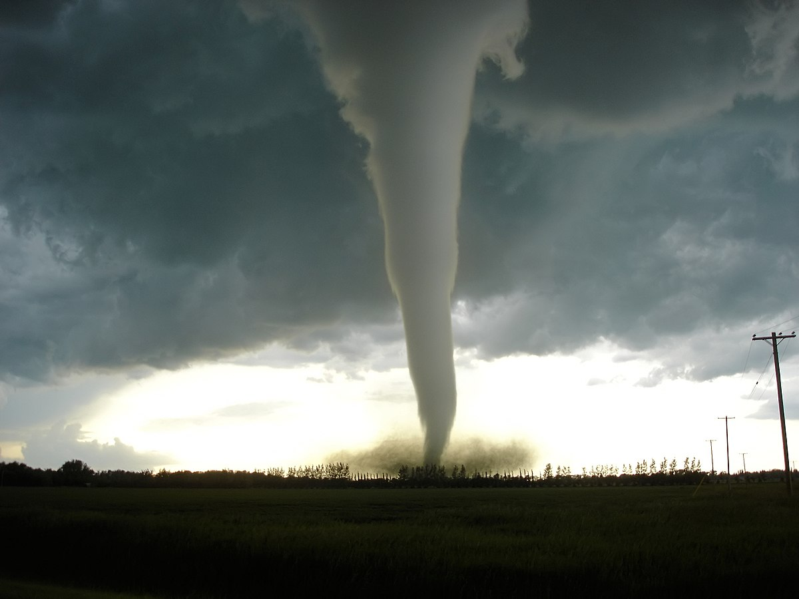

```{r setup, include = FALSE}
knitr::opts_chunk$set(eval = FALSE)
```

```{r photo, fig.margin = TRUE, echo = FALSE, fig.width = 3, fig.cap = "F5 tornado. Source: Wikipedia", eval = TRUE}

```

# Academic integrity and honor code

This homework is designed to help you practice a complete data analysis workflow with less provided code. **Generative AI tools are not permitted for this assignment.** This includes ChatGPT, Claude, Gemini, Copilot, Grok, and similar tools that can generate or revise code, written answers, interpretations, or assignment content.

By completing and submitting this homework, I certify that:

- I completed the submitted work myself.
- I did not use generative AI to generate, debug, revise, or interpret code or written answers for this assignment.
- I may use course materials, lecture notes, R documentation/help files, and other resources explicitly approved by the instructors.
- I understand that I am responsible for being able to explain all code and written work that I submit.

**Name:** Mo Narciso  
**Signature:** Mo Narciso  
**Date:** 10/21/26

> **Important:** Signing this statement is part of the assignment. The same statement appears in your starter file; complete it there as well.

# Homework overview

You will work with tornado path data from the NOAA Severe Storm Database. Each row is one tornado that hit the United States (and associated damages) from 1950 onward.

## Learning goals

By the end of this homework, you should be able to:  

  A. Import a CSV, select columns, and overwrite an object.  
  B. Identify and correct a non-numeric value that prevents a column from being numeric.  
  C. Write a cleaned data frame back to CSV and re-read it with the correct type.  
  D. Build a faceted scatter plot that maps multiple aesthetics and interpret the result.  

## Deliverable

Complete **`hw-05-starter.Rmd`**. Your finished starter file should contain your code, plots, and written responses and should Knit successfully from top to bottom.

## Reproducibility rule

Your analysis must work from top to bottom. Knit frequently.

## Before asking for help

Check spelling, parentheses, quotation marks, package loading, and Knit errors first. Then ask Dr. Gavin McNicol or TA Kayode Ayegbusi and show them the code and the error.

# Getting started

If you are reading a knitted copy of these instructions, treat the steps below as review.

- Open your Unit 5 GitHub repository (`unit-5-yourlastname` under the `EAES-380` organization).
- Clone it into RStudio Cloud if you have not already.
- Open `hw-05-instructions.Rmd` and Knit it.
- Open `hw-05-starter.Rmd`. **This is the file you will complete.**

# Warm-up: R Markdown + Git

Open `hw-05-starter.Rmd`, put your name and today's date in the YAML, sign the honor code, Knit, commit (`Update author and honor code`), and push. Confirm that both the `.Rmd` and the knitted output are on GitHub.

# Packages and data

```{r load-packages-demo, message = FALSE}
library(tidyverse)
```

The data file is `data/tornado-path.csv`.

# Exercises

Complete each exercise in `hw-05-starter.Rmd`. Write interpretations in complete sentences. No code chunks are provided; you will write them yourself.

## Exercise 1 — Import and inspect

**Goal:** Read the tornado data and report its size.

Insert and label a code chunk that reads the tornado data into an object with a sensible name. Glimpse the object. State below the chunk how many rows and variables the data set contains.

### Exercise 1 checkpoint

🧶 ✅ ⬆️ **Knit, commit, and push.** Suggested commit message: `Complete Exercise 1`.

## Exercise 2 — Select and overwrite

**Goal:** Keep only the columns needed for later steps.

Insert and label a code chunk that reads the data again and then, in a short pipeline:

- selects only `storm_date`, `storm_time`, `state_name`, `magnitude`, `fatality_count`, `length`, and `width`
- assigns the result so that it **overwrites** the object created in Exercise 1

## Exercise 3 — Spot the problem and write a CSV

**Goal:** Identify a data-quality issue and save the selected columns.

Insert and label a code chunk that looks at the overwritten object. In text narrative under the chunk, comment on what is strange about the variable `magnitude`. Then add and label a second code chunk that writes the current data frame as a `.csv` to the `data/` directory, using the same name you gave the R object.

### Exercise 3 checkpoint

🧶 ✅ ⬆️ **Knit, commit, and push.** Suggested commit message: `Complete Exercises 2 and 3`.

## Exercise 4 — Re-read and fix magnitude

**Goal:** Import the file you just wrote and correct the type of `magnitude`.

Insert and label a code chunk that reads the new `.csv` file (not the original `tornado-path.csv`). Add an argument to `read_csv()` that fixes `magnitude`. Assign the result to a new object name. Add one further line of code to view the new object. Confirm the issue with `magnitude` is resolved.

## Exercise 5 — Faceted scatter plot

**Goal:** Explore fatalities by time of day, magnitude, state, and width.

Filter the new data object to only include the states `"Kansas"` and `"Oklahoma"`, then:

- pipe the result into `ggplot()` to create a faceted scatter plot of time of day (x) versus fatalities (y)
- the facets should each correspond to a different magnitude value
- different states (`state_name`) and the range of tornado widths (`width`) should be visible with reasonable aesthetic mappings
- improve the clarity of the axis labels with `labs()` and pick a theme layer of your choice
- view your plot: what patterns do you see?
- beneath the output, write a narrative response about the conditions under which tornado fatalities are generally the highest and any caveats to your interpretation

**Note:** You will receive credit for every correct line of code, even if the entire plot is not perfect or does not plot because of an error. Make an attempt at all the steps.

### Exercise 5 checkpoint

🧶 ✅ ⬆️ Knit, commit, and push with a message such as `Complete HW 5`. Confirm GitHub shows the final files.

# Submission checklist

- [ ] I signed the academic-integrity statement in both files.
- [ ] My name and date are correct in the starter YAML.
- [ ] I answered every requested question in complete sentences.
- [ ] All required code is in `hw-05-starter.Rmd`.
- [ ] The document Knits from top to bottom without errors.
- [ ] I committed and pushed the final version to GitHub.
